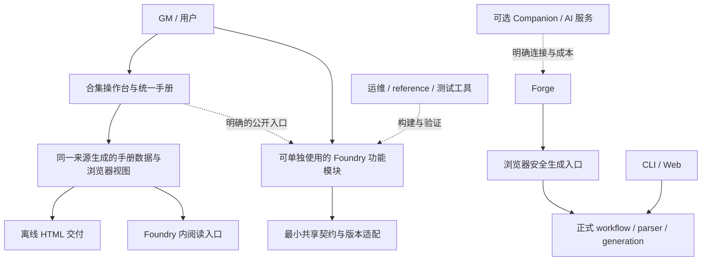
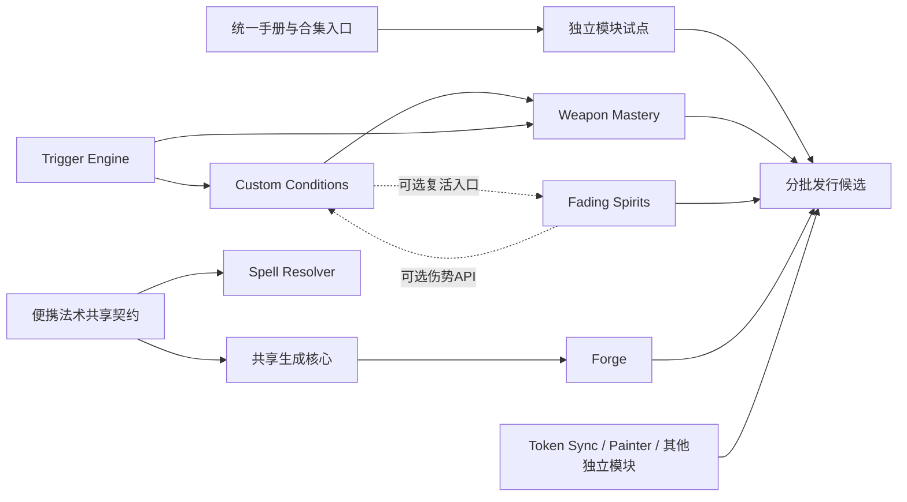

# FVTT 工具合集渐进重构总计划

- 日期：2026-10-11；版本：规划 v1。
- 架构负责人：本聊天主控，负责整体设计、模块取舍、接口一致性、集成裁决和最终证据审阅；具体实现可按清晰归属分工。
- 用户已确认的方向：一个工具合集、统一操作手册进入 Foundry、按功能逐模块渐进重构。
- 本次授权：2026-10-12用户明确先做H4的Foundry模块包和离线手册交付准备，完成后沿总计划依赖顺序连续推进各小计划，直到结束或确实必须停下；不启用goal模式，不为普通步骤逐次询问。H1/H2及H3限定功能证据保留，继续避开Forge使用的5.3.3 Mirror。仓库改名、提交、合并、推送、生产或公开发布仍按具体已有权限处理，连续实施授权不代替发行授权。
- 源码基线：已提交 `master` / `3734eb2`；本轮规划与前一轮更名/手册候选共用同一任务 sibling worktree，不读取其他工作树的未提交实现作为既定基线。
- 当前进度唯一入口：[执行总账](EXECUTION_LEDGER.md)；全部模块与子计划：[模块索引](MODULES.md)。

## 1. 要交付的产品

GM 安装合集入口后，能在 Foundry 内找到统一操作手册、了解每个工具的用途和支持范围，并按需使用已有模块。每个功能模块保持明确归属、独立构建和发布能力；单独安装时也能找到自己的帮助。用户不需要理解仓库目录，也不需要启用整个合集才能使用其中一个功能。

“合集”是对用户的产品组合；“Foundry 模块”是安装和更新单元；`packages/` 是共享源码。三者不要求一一对应。紧密相关、共用状态和生命周期的功能保留在同一个模块内；仅当用户选择、依赖、权限或更新周期确实不同，才拆出新的安装单元。重构的目标是减少理解和修改成本，不以拆文件数量衡量成果。

### 规划完成与实施完成是两件事

本次规划应给出全部现有模块的去向、依赖顺序、具体切片和可执行的验证入口，并对统一手册给出独立子计划。它不证明任何新功能已实现。整个实施项目完成，则要求选定发行范围的模块满足下述模块准入、真实使用和发行条件；未选择的内容包、外部适配和历史兼容不得混入“全部通过”。

## 2. 当前事实与约束

- 已有 Bun workspace：`apps/`、`packages/`、`foundry-modules/`、`tools/`；已有依赖方向与循环检查，继续使用。
- 当前 17 个 `foundry-modules/` owner 目录中有 15 个自有功能 owner，以及 Midi/外部候选适配区域；后两者不能直接当作自有商品。
- 统一手册由 `docs/handbook/` 的内容、来源、review 指纹和 renderer 生成根 `工具手册.html`。规划基线有35项，H2新增合集手册自身条目后为36项；H3把Deck说明归回模块owner并保留全部ID、目录覆盖与来源检查。
- 前一轮 Web 更名已在正常 Chrome 接受；手册 DOM/build/check 通过，但 file URL 被连接器安全策略拒绝，正常 Chrome/窄屏仍未执行。这个缺口保留，不能由新计划改写。
- Forge 的另一工作树正在使用 dnd5e 5.3.3 Server Mirror。本轮完全不访问或操作该实例；后续 Forge 接续先取得该工作的已提交基线和可用运行窗口。
- 当前支持和历史案例以[支持矩阵](../../acceptance/current-support-matrix.md)及各原始记录为准。manifest 区间、包版本和实际行为接受分开记录。
- 旧 [2026-07-31 架构重组](../2026-07-31-project-classification-and-architecture-reorganization.md)已完成。本计划是下一轮产品化和内部改进，不重新执行旧搬迁，也不自动关闭旧整改 finding。

## 3. 目标结构

### 3.1 合集入口的职责

合集入口模块的技术工作名为 `fvtt-suite-console`，H2已实现只读窗口；正式品牌和新增持久 ID 在写入用户数据或正式发行前定稿。入口第一阶段只负责导航、阅读帮助；H3再展示安装状态和已记录的支持范围。后续需要启动工具时，只调用目标模块已公开、已验证的入口，缺失时显示明确原因。

入口不拥有角色生成、状态结算、伤害、战场对象或复活逻辑，不自动安装/启用所有模块，不成为公共 Hook 总管或收费授权服务器。它的缺失或关闭不能让独立功能模块失效。

### 3.2 功能模块的职责

每个模块拥有自己的业务、状态、生命周期、权限、版本适配、manifest、构建、用户帮助和接受记录。模块之间通过公开接口协作；不导入彼此的私有源码。共享 package 只承载已有多个真实消费者需要的契约或实现，不为目录整齐建立一层层转发。Species 等纯内容模块继续纯内容，可通过随包说明/内容入口提供独立帮助，不为统一手册强行加入 runtime JS。

优先把已有大文件中可独立理解和验证的状态/流程分离，再考虑物理目录调整。已有良好结构的模块可以只补手册、版本证据和发行一致性，不强迫改写其实现。

### 3.3 本机与开发能力

浏览器安全的 parser/generation 可按现有正式入口构建进模块；OCR、需要进程的转换、Provider 凭据保管和运维能力仍保留适当的本机或服务执行位置。用户界面可以统一，执行位置按实际能力决定。运维资料、reference cache、测试材料与个人来源不进入商业模块 ZIP。

## 4. 统一操作手册是首个产品切片

详细实施见[合集操作台与统一手册](modules/fvtt-suite-console.md)。它必须先于逐个模块大幅改动，作为整个合集的稳定使用入口。

1. **同一内容来源、两个交付目标**：继续生成离线 HTML，同时构建 Foundry 内手册。现有 HTML 不是废弃物，也不逐模块复制另一份说明。
2. **内容与宿主解耦**：把手册数据、搜索和浏览器视图与全局 document、location.hash、body/CSS、剪贴板和主题依赖分开。Foundry 宿主使用本地路由和独立容器，遵守现有 ApplicationV2 模式。
3. **各模块维护自己的内容**：先完整迁入现有条目与稳定 ID，再逐模块把帮助正文归到 owner；集中索引只做发现与组合。保留 sources、watch、人工 review 和严格构建检查，不以迁移丢掉工具覆盖。
4. **兼容信息说清来源**：用户看到“未安装”“未启用”“当前版本未接受”“已有某个范围的接受”。读取 manifest 只说明声明，不自行推断运行通过；未安装模块也可以阅读用途和安装前准备。
5. **帮助不执行操作**：代码和命令按文本显示，复制与执行分开；不提供任意脚本求值，不从文档直接运行 Bun、运维命令或世界写入。
6. **独立使用也有帮助**：模块可以调用合集公开帮助入口；合集未安装/未启用时，提供同来源的本模块帮助或随包说明。共享 viewer 可构建进各模块，无需先增加必装的运行库模块。

Foundry 内的正式手册入口是新产品功能，需要按其真实宿主和构建物验收；它不能作为把此前被拒绝的 file URL 偷换为 HTTP 并追认旧视觉 PASS 的办法。

## 5. 双系统线、默认值与身份保护

| 项目 | 实施策略 |
| --- | --- |
| Foundry 平台 | V14 为主要平台，Core/系统仍核对精确组合；不在重构中顺带升级 Core |
| dnd5e 5.x | 固定 5.3.3 维护，保留对应行为；不得因 6.x 查询结果自动升级 Mirror |
| dnd5e 6.x | 执行时按[版本流程](../../runbooks/dnd5e-version-following.md)核实最新稳定 6.x、实装版本和模块全集；历史 6.0.5 是证据目标，不是永久最新值 |
| 版本适配 | 靠近实际变化的功能；已有不同实现才建立 Adapter，不复制整个产品，也不先造全能版本框架 |
| 发布物 | 按模块决定一个双线包或目标构建变体；同一既有 module ID 保持稳定，清单明确实际支持组合，避免更新时静默跨线 |
| V12 | 不进入新合集的默认承诺。先审计调用方，再单独把 CLI 默认改为 V14；保留必要历史回归，最后逐项提出退役，不自动删除 |
| 既有数据身份 | module ID、flags namespace、settings key、Compendium/Document UUID、sourceId、草稿/审核身份与宏绑定继续稳定 |

更改品牌、仓库名、package scope 和 manifest/download 地址单独实施，先有旧用户更新路径。不会通过一次全仓字符串替换同时修改持久身份。

## 6. 实施顺序与出口

默认逐个推进一个可审阅切片。同一状态家族只有一个 writer；只有接口和写入范围互不耦合时才并行。以下顺序是架构建议，不是已经执行或未来每一步都要再询问的审批流水线。

| 阶段 | 交付 | 出口与后继 |
| --- | --- | --- |
| P0 规划与基线 | 本总计划、模块索引、全部子计划、唯一执行总账 | 文义、路径、命令和 owner 覆盖检查通过；实施仍未开始 |
| P1 统一手册与合集入口 | 内容/宿主分离；离线交付保留；Foundry 内只读手册和清晰导航 | 真实 ApplicationV2 宽窄窗口、搜索、返回、复制、主题；手册操作导致的世界文档写入与game.settings值变更均为零 |
| P2 首个独立功能试点 | 建议 Open Session Deck：用户可见，已有 store/controller/系统 adapter，可验证模块准入流程 | 独立使用与合集帮助两条真实路径；目标版本、生命周期、升级和恢复证据；不要求先动 Forge |
| P3 规则依赖家族 | Trigger Engine → Custom Conditions → WMP；IFS按可选CC协作接续，Token Sync留在独立模块阶段 | 事件/状态/消费不重复；版本组合与受影响玩法的来源语义、真实运行、恢复闭合 |
| P4 内容制作 | 共享生成核心与便携法术契约；Forge、Resolver 各自接续 | 先对接正在进行的 Forge 成果；生成/水合是相邻用户流程，没有既定的模块硬依赖；正式来源链、创建/读回及旧数据保护保持 |
| P5 独立辅助与内容包 | Chat Guard、Monitor、House Rules、Painter独立功能、Babele、Species、Blood Hunter | 各模块按自己的价值和证据逐个准入；内容包分发范围明确，外部补丁仍独立治理 |
| P6 分批发行 | 只组合达到准入条件的模块；统一手册、目标清单、更新渠道和发行白名单 | 锁定运行时的必要整合 CI、正式客户端接受、用户授权的 Git/外部发行；无需等待全目录都完成才有首个发行候选 |

P2 是验证完整交付方法的试点，不能为试点强拆已经合理的代码。P3–P5 的队列可按用户价值调整，但依赖约束不能跳过。第一批收费功能与价格由用户决定；在这之前，技术重构可以按已授权的切片准备，不必为未定品牌停掉全部工作。

实线表示计划中的顺序或已知强协作；虚线协作是否必须启用，以模块真实接口/版本门为准，不把图当作 manifest 的自动修改指令。CC 与 IFS 现有协作是双向可选公开 API；Token Sync 独立，实际冲突项为启用中的 multistatus。Forge、Resolver 和 Painter 的当前源码没有相互模块调用链，不为图形整齐新增依赖。

## 7. 每个模块的准入与完成标准

全部子计划使用[共同实施约定](MODULE_CONTRACT.md)，但各自列出具体变化和业务断言。完成一个模块至少回答：

- 用户做什么、从哪里进入；哪些功能属于本模块，哪些只通过公开接口协作。
- 本轮实际改变了什么；保留了哪些已接受行为和持久身份；是否根本无需内部重构。
- 最小检查怎样证明该变化；哪些来源/视觉/真实行为必须补测，哪些旧证据仍可复用。
- 两条系统线分别接受了哪些范围；不支持、未测试和失败如何呈现。
- 独立模块、合集入口和操作手册如何一致；安装/升级/禁用/重新启用及任务资源结束如何验证。
- 是否已进入 master/远端/发行。代码、运行接受和发布状态分开，不用其中一层替代另一层。

测试不因模块数量机械翻倍。先局部检查和一条真实边界，再按实际接口影响补组合；完整 CI 在整合边界运行。修改 parser/generation 继续保留来源 fixture、结构检查、语义验收和局部 anti-overfit。报告/清理工具失败只修对应层，不重放独立有效的业务。

## 8. 发行与商业边界

一个套餐可以包含多个独立模块，无需一个巨型 ZIP。首批发行按真实完成清单组合，并明确依赖、Core/系统线、数据/内容来源和实际接受范围。AI 的 Provider/Key、可选托管额度和维护周期分别说明，不在没有成本数据时承诺无限 AI 或终身兼容。

本轮不设价格、不接支付、不增加运行时 DRM、不创建商品。自有工具、第三方代码、规则内容、翻译和媒体分别核对实际 release 白名单；外部候选不能仅因放在仓库就变成可售资产。已核的发行背景与官方来源见[前轮审计](../../reviews/2026-10-11-fvtt-suite-product-architecture.md)，正式发行时重核适用条件。

## 9. 责任、授权与正在进行的工作

架构负责人负责技术取舍、总/子计划同步、依赖顺序、共用接口和最终接受；模块执行 owner 负责其实现与相关测试。独立审查只在能减少实际风险时使用，不固定套用全角色流水线。用户决定品牌、收费、主要用户功能和不可逆的兼容/数据/发行取舍；普通可逆技术选择由执行者在授权范围内完成。

规划阶段只写计划；实施先完成H1/H2及H3命名功能，当前按用户连续授权从H4开始，依次完成Deck剩余D1→D2→D3，再按P3–P5依赖顺序推进可用工作。没有H5编号时按真实子计划接续，不虚构阶段。局部阻塞只延后依赖它的工作，继续其他独立范围；必要产品决定、Forge基线/运行交接、Git或外部发行权限不足时先准备具体可审阅结果再指出阻塞。commit/merge/push、外部发布、生产写入、新聊天/跨聊天消息及现有工作区内容整合，仍遵守实际已有权限。

当前 Forge 工作树、Mirror、其他 dirty/untracked 内容完全保护。其成果没有进入已提交主线前，本计划不假装拥有“最新 Forge”；需要依赖时先记录准确来源、由 owner/用户决定整合，不能复制脏树或用旧 master 覆盖。

## 10. 本次规划的验证选择

最初的文档规划阶段只核对owner/manifest/公开接口、链接、现有命令、覆盖和文义一致性，没有执行计划中的业务或运行测试。后续实施的检查选择、候选安装、真实接受及未执行范围按切片写入总账。文档若被现有手册sources/watch关注，按实际stale项人工核对，不缩小监测；否则复用仍有效的手册检查。

规划检查结果、剩余产品决策、下一切片和授权范围都写入[执行总账](EXECUTION_LEDGER.md)。未来 implementation 的每次接受记录在对应子计划指向的位置，不能用本文件的勾选项制造运行 PASS。
